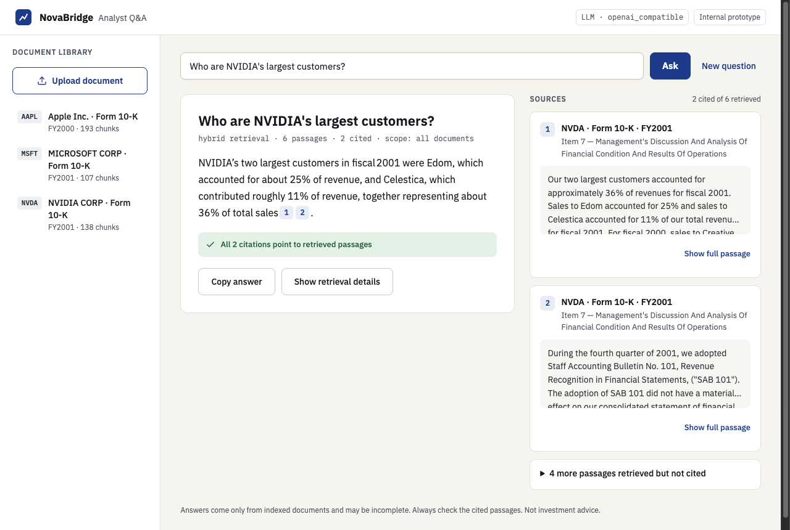
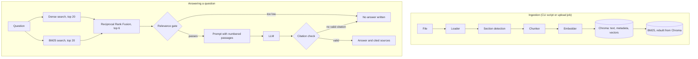

# NovaBridge Analyst Q&A

An internal prototype for a fictional advisory firm. Analysts ask questions about financial filings
and get a short answer with numbered citations they can open and check. When the documents do not
support an answer, it says so and writes none.



## Quick start

You need Docker and a key for an LLM provider. Groq has a free tier.

```bash
cp .env.example .env
# In .env, set LLM_API_KEY and LLM_MODEL (check your provider's current model list).
docker compose up --build
```

Open <http://localhost:8080>. The API docs are at <http://localhost:8080/api/docs>.

The first start builds the images, then indexes the filings. Later starts take about 10 seconds.
Uploads and the index live in the `data` volume, so `docker compose down` keeps them and
`docker compose down -v` removes them.

### Local development

Settings come from the same `.env` in the repository root. Requires [uv](https://docs.astral.sh/uv/)
and Node 22.

```bash
cd backend
uv sync
uv run python scripts/ingest.py
uv run uvicorn novabridge_qa.main:create_app --factory

cd frontend          # in a second terminal
npm install
npm run dev          # http://localhost:5173, with /api proxied to port 8000
```

## Configuration

All settings are in [.env.example](.env.example), with comments. Switching LLM provider only takes
a change to `.env`, followed by a restart:

| Provider | Settings | Status |
|---|---|---|
| Groq (default) | `LLM_API_KEY`, `LLM_MODEL` | Tested end to end |
| OpenAI | Also `LLM_BASE_URL=https://api.openai.com/v1` | Not run. Same adapter as Groq |
| Ollama | `LLM_BASE_URL=http://ollama:11434/v1`, `LLM_MODEL`, any text in `LLM_API_KEY`, then `docker compose --profile local-llm up --build` and `docker compose exec ollama ollama pull <model>` | Compose config validated only. Never run with a model |
| Anthropic | `LLM_PROVIDER=anthropic`, `ANTHROPIC_API_KEY`, `ANTHROPIC_MODEL` | Unit tests only. Not yet run against the real API |

## Architecture



- `backend/src/novabridge_qa/`: `ingestion/`, `retrieval/`, `llm/`, `qa/`, `api/`, with `domain/` for
  shared types. `container.py` does the wiring.
- `frontend/src/`: React, with TanStack Query for server state.
- Compose runs `ingest` once, then `api` (uvicorn), then `web` (nginx serving the build and
  proxying `/api`).

## Design decisions and trade-offs

| Decision | Why | Trade-off |
|---|---|---|
| **Plain Python, no LlamaIndex or LangChain** | Chunking, fusion, the prompt and the citation check are the core of this task, so they should be visible and testable. LlamaIndex would duplicate the LLM adapters and hide the citation logic in its templates. | More code to own |
| **LLM behind an adapter**, chosen in `.env` | Runs free on Groq or Ollama, and tests use a fake | A small interface to maintain |
| **Embedder separate from the LLM** | Anthropic has no embeddings API, so the two cannot share a provider | Two settings instead of one |
| **`bge-small-en-v1.5` through fastembed** | Small ONNX model that is fast on CPU, local and free | 512-token limit, so chunks stay at 400 |
| **Hybrid search with hand-written RRF** | Filings mix exact terms, where BM25 wins, with paraphrased questions, where dense wins. RRF needs no score calibration. | Two indexes to keep in step |
| **Cross-encoder re-ranker** (`jina-reranker-v1-tiny-en`) on the top 20 after RRF | RRF ranks a passage found by both retrievers above any passage found by one, which dropped 6 of the 9 misses. Reading the question and passage together raised R@6 at 400 tokens from 0.83 to 0.92 (HTML) and 0.76 to 0.81 (TXT). Chosen from six fastembed models on recall, speed and license. | About 0.5 s more per question on CPU, and 129 MB more model in the image. `RERANKER_MODEL=` turns it off |
| **Chroma as the source of truth** | Embedded with no operations work. BM25 is derived from it and can always be rebuilt. | One process at a time, which is why ingest runs before the API |
| **Citations checked on the server** | The model's citations are parsed, invalid numbers dropped, the rest renumbered. No valid citation counts as no answer. | A correct answer with no parsable citation is discarded |
| **Two no-evidence layers** | A similarity gate stops off-topic questions without calling the LLM, and the model can refuse the rest | The gate cannot catch in-domain questions (see below) |
| **Title and section added to indexed text** | Filings say "the Company", so chunks had no link to the company a question names. Stored and cited text stays verbatim. | Slightly more text to embed |
| **SEC EDGAR filings as the corpus** | Real, relevant and public domain, so they can be committed | See the limitations on their age |
| **Upload as a background job** | Embedding is slow, so the request returns at once and the UI polls | In-memory jobs, one uvicorn worker. Production would use a queue such as Celery, RQ or Arq with a persisted job table |
| **Vite, React, shadcn/ui, TanStack Query** | Components live in the repository and can be styled to the design. TanStack Query replaces hand-written loading and polling code. | Tailwind and Radix become dependencies |
| **Models baked into the image** | No download on first start | The embedder is 65 MB and the re-ranker 129 MB. The `api` image is 1.27 GB |
| **`sentence-transformers` and `torch` as an optional extra** | Only needed for the planned embedder comparison, and `torch` alone is about 700 MB | That provider does not work in Docker, and needs `uv sync --extra sentence-transformers` locally |

## Retrieval evaluation

`backend/eval/run_eval.py` runs 45 answerable and 8 unanswerable questions written for these
filings: 21 on the fiscal 2000–2001 TXT filings and 24 on the 2026 HTML ones. Recall@k is the
share of answerable questions whose evidence, from the filing the question names, is in the top k
passages. All six filings are indexed. At the chosen 400 tokens:

| Mode | Questions | R@1 | R@3 | R@6 | R@10 | MRR |
|---|---|---|---|---|---|---|
| **Re-ranked** | TXT filings | 0.62 | 0.67 | 0.81 | 0.81 | 0.676 |
| **Re-ranked** | HTML filings | 0.58 | 0.83 | 0.92 | 0.92 | 0.715 |
| Hybrid | TXT filings | 0.33 | 0.62 | 0.76 | 0.81 | 0.496 |
| Hybrid | HTML filings | 0.58 | 0.79 | 0.83 | 0.83 | 0.684 |
| Dense | TXT filings | 0.33 | 0.57 | 0.71 | 0.76 | 0.484 |
| Dense | HTML filings | 0.54 | 0.71 | 0.75 | 0.88 | 0.642 |
| BM25 | TXT filings | 0.24 | 0.38 | 0.52 | 0.71 | 0.361 |
| BM25 | HTML filings | 0.29 | 0.71 | 0.75 | 0.79 | 0.487 |

With only the TXT filings indexed, hybrid R@6 on the same 21 questions was 0.86 (MRR 0.647). The
2026 filings answer some of the same questions for another year, which pushes the old evidence down.
The 2026 questions were approved by hand, and nothing has been tuned on them.

**Most misses are ranking, not retrieval.** Each retriever passes its top 20 passages to fusion,
and at 400 tokens one of them finds the evidence for 0.96 of the HTML questions and 0.90 of the TXT
ones. Of the 9 questions hybrid misses in the top 6, 6 were among those candidates. RRF puts a
passage found by both retrievers above any passage found by only one, which drops them. Details are
under "Candidates before fusion" in [decisions.md](backend/eval/decisions.md).

**The re-ranker recovers half of them.** A cross-encoder re-orders the top 20 passages after RRF.
At 400 tokens it finds 3 more questions in the top 6 (`a25`, `n24`, `n02`) and loses none, at
about 0.5 s more per search. It reaches the most that 20 candidates allow: the other misses are
not in the fused top 20, or not found at all. The model comparison is in
[decisions.md](backend/eval/decisions.md) under "Re-ranker".

**Tuned:** `CHUNK_TOKENS` stayed at 400, `TOP_K` at 6 and `MIN_RELEVANCE` became 0.58. Adding the
indexing header raised hybrid R@6 from 0.76 to 0.86.

**Read these with care.** One question moves recall by 0.048, most gaps are one or two questions, and
the same questions guided the tuning, so the scores are optimistic. Hybrid is a judgment call rather
than a clear win: at 200 tokens dense scored higher. Details are in
[results.md](backend/eval/results.md) and [decisions.md](backend/eval/decisions.md).

### Answer evaluation

`backend/eval/run_answer_eval.py` asks every question through the real pipeline and checks each
answer against facts written for it ([answer_results.md](backend/eval/answer_results.md), raw
answers in `backend/eval/answer_runs/`). Two runs with `openai/gpt-oss-120b` on Groq, all six
filings indexed, before and with the re-ranker:

| Questions | Answered | Correct | Evidence cited | Answered from the other filing |
|---|---|---|---|---|
| HTML filings (24), with re-ranker | 23 | 23 | 22 | 0 |
| TXT filings (21), with re-ranker | 19 | 17 | 16 | 1 |
| HTML filings (24), before | 23 | 21 | 20 | 1 |
| TXT filings (21), before | 17 | 15 | 15 | 2 |

All 8 unanswerable questions were refused in both runs: the 3 off-topic ones by the relevance gate,
the 5 in-domain ones by the model. No answerable question was refused without a retrieval miss
behind it. With the re-ranker a median answer took 1.5 seconds (0.8 before): retrieval went from
26 ms to 585 ms, and generation stayed at about 0.8 s. Each answer used about 3,000 tokens.

Every answer scored wrong was read. The re-ranker made 4 answers correct (`a25`, `n24`, `m02`,
`n02`) and none wrong. The rest are retrieval misses that the model refused, and old questions with
no year answered from the 2026 filings. The first run had one real error: `a25` reported Apple's
remaining buyback authorization ($114 billion) as the cost of its buybacks, because the HTML loader
drops empty table cells and shifted the figure into the wrong column. With the re-ranker it answered
from a text passage instead, but the loader bug is still open. Each is a single run at temperature
0.1, and "correct" is a pattern match on the expected facts, not a judgment of the whole answer.

## How hallucination is limited

1. **Prompt:** the model may use only the numbered passages, must cite every claim, and must reply
   with a fixed marker if they do not answer the question. Passage text is marked as data, in
   delimiters that uploaded text cannot close.
2. **Relevance gate:** if the best dense similarity among the retrieved candidates is under
   `MIN_RELEVANCE`, the LLM is never called. Re-ranking happens after it and cannot open it.
3. **Citation check:** only passages the answer really cites come back as sources.

**What this cannot guarantee:**

- A citation proves that the passage was retrieved, not that it supports the sentence. The analyst
  still has to check, which is why the sources sit beside the answer.
- The gate only stops off-topic questions (highest score 0.528 against the 0.58 threshold).
  In-domain unanswerable questions score up to 0.716, above the lowest answerable one (0.665), so
  no threshold separates them and they depend on the model refusing.
- A document's false claims can reach an answer. In a test, instructions planted in a passage were
  ignored, but a planted figure was still reported as a conflict with the true one, cited to its real
  passage. It stays traceable, but no prompt can tell a false document from a true one
  ([details](backend/eval/decisions.md#what-prompt-injection-can-still-do)).

## Limitations and next steps

- **Two generations of filings:** the index holds each company's fiscal 2000–2001 10-K (plain text)
  and its 2026 10-K (HTML). A question without a year can get both, with the period of each figure
  stated. There is no period filter yet.
- **Formats:** TXT, Markdown and HTML (inline XBRL included). PDF comes next, then OCR.
- **Updating an existing Docker install:** the filings are copied into the `data` volume only when
  it is empty, so an older volume keeps its old manifest. Run `docker compose down -v` once.
- **Embedders:** a comparison of `bge-small` with Qwen3-0.6B and harrier-0.6b is planned.
- **Tables:** in HTML a table is kept in one chunk when it fits (88% of them). A longer table, and
  most tables in the TXT filings, can lose the header row in later chunks.
- **Uploads:** they have no ticker, so they appear under "My uploads", not under a company.
- **Rate limits:** Groq's free tier allows roughly 2–3 questions a minute at about 3,000 tokens each,
  and has a daily token cap too. Once it is used up, questions fail with a friendly message until it
  resets, even though small requests still get through.

- **Re-ranking cost:** the cross-encoder adds about 0.5 s to each search on CPU, and its cost grows
  with the number of candidates and their length. A GPU or a hosted re-ranker would cut it.

For production: authentication, a job queue with persisted jobs, a server-based vector store,
faithfulness checks on answers, and monitoring.

## Testing

```bash
cd backend && uv run ruff check . && uv run ruff format --check . && uv run mypy src && uv run pytest
cd frontend && npm run lint && npm run typecheck && npm test
```

- **Backend (318 tests):** loaders (TXT and HTML), chunking, sections, RRF, re-ranking, citations, prompts, settings, the QA service with
  fakes, and the API through `TestClient`. No network or API keys needed.
- **Frontend (31 tests):** citation rendering, retrieval details, API client errors and upload queue state. These are
  deliberately few. The full flow was checked by hand-written scripts in a real browser rather than
  automated tests in the repository.
- **Retrieval quality:** `eval/run_eval.py`, run by hand, with results committed.
- **Answer quality:** `eval/run_answer_eval.py ask` runs every question through the real LLM, paced
  under the rate limit and resumable, and saves raw answers in `eval/answer_runs/`.
  `eval/run_answer_eval.py score` checks them offline and writes `eval/answer_results.md`.
- CI runs the backend and frontend checks on every push. It does not build the Docker images.

## AI assistance

Everything was built with AI assistance, and the full logs are in [ai-logs/](ai-logs/).

- **Claude app:** planning, which produced [the handoff](docs/HANDOFF.md) and [the designs](docs/design/).
- **Claude Code:** the implementation, milestone by milestone, with a review before each next one.

Direction that changed the plan: starting with TXT files and adding other formats gradually, using
fastembed first and deferring the embedder comparison, documenting the prompt-injection limitation
rather than adding a prompt rule that only stops its clumsiest form, and keeping frontend tests few.

Places where generated code was wrong, and how it was caught:

| Problem | Caught by |
|---|---|
| The first real model run answered only 5 of 21 questions. `gpt-oss` writes citations as `【1】`, which the parser missed, so correct answers were discarded. | Running against the real model. Tests with a fake LLM had passed |
| The sentence splitter cut chunks after "Mr." and "Ltd.", separating names from what was said about them. | Reading chunks by hand. Tests had passed |
| An unanswerable eval question was not unanswerable: "data center" does appear in the corpus. | Checking the eval set against the filings |
| Embedding with `sentence-transformers` was about 10 times slower in bfloat16. | Timing it, then forcing float32 |
| The upload dialog lost keyboard focus on closing, and shadcn's dark styles broke the light design on dark-mode systems. | A real browser run and its screenshots. Tests had passed |
| A CI action was pinned to a tag that does not exist, so the first two runs failed. | CI |
